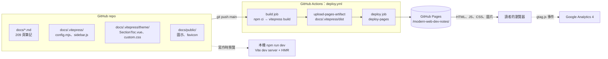
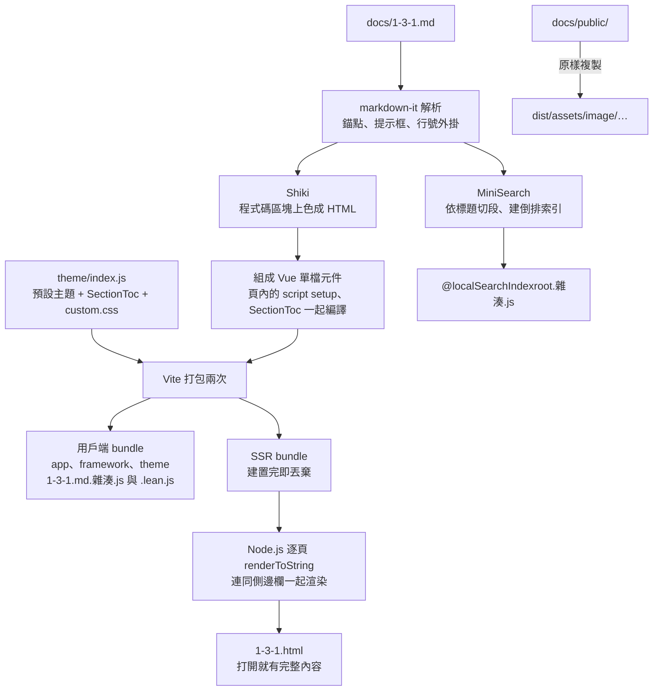
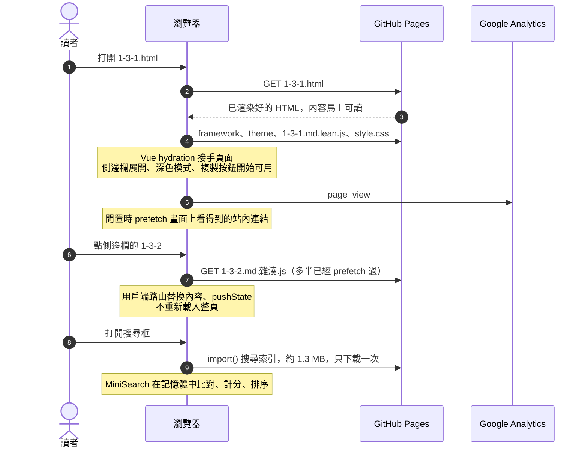

# 技術與架構

這份文件說明 Modern WEB Dev Notes 用了哪些技術，以及一頁 Markdown 從寫好到出現在讀者瀏覽器裡，中間經過哪些步驟。寫作規則、本機指令請看 [README](README.md)。

整個網站是**純靜態網站**：沒有後端、沒有資料庫。所有頁面在 GitHub Actions 上一次建置成 HTML，放到 GitHub Pages；搜尋、換頁、深色模式都在瀏覽器裡完成。

數字以 2026-11 的建置結果為準。

## 使用的技術

| 分類 | 技術 | 版本 | 用途 |
| --- | --- | --- | --- |
| 網站產生器 | [VitePress](https://vitepress.dev/) | 1.6.4 | 把 `docs/*.md` 建置成靜態網站，提供預設主題、側邊欄、本頁目錄、上下頁導覽 |
| 前端框架 | [Vue](https://vuejs.org/) | 3.5 | VitePress 的底層。每頁 Markdown 會被編譯成 Vue 元件，自訂元件 `SectionToc` 也是 Vue |
| 建置工具 | [Vite](https://vite.dev/) | 5.4 | 開發時的 dev server 與熱更新（HMR）；建置時用 Rollup 打包、加上檔名雜湊 |
| Markdown 解析 | [markdown-it](https://github.com/markdown-it/markdown-it) | 14 | 打包在 VitePress 裡。錨點 `{#id}`、提示框 `::: info`、程式碼行號都是它的外掛 |
| 語法高亮 | [Shiki](https://shiki.style/) | 2.5 | 建置時就把程式碼上色成 HTML，瀏覽器不用跑高亮程式 |
| 全文搜尋 | [MiniSearch](https://github.com/lucaong/minisearch) | 7.2 | VitePress 的 `local` 搜尋。建置時產生索引，瀏覽器端查詢，細節見 [README 的站內搜尋](README.md#站內搜尋) |
| 執行環境 | Node.js | 22 | 本機開發與 CI 建置（VitePress 最低需求 18） |
| CI/CD | GitHub Actions | — | push 到 `main` 時自動建置並部署，流程在 [`.github/workflows/deploy.yml`](.github/workflows/deploy.yml) |
| 主機 | GitHub Pages | — | 放建置好的靜態檔，網址前綴 `/modern-web-dev-notes/` |
| 流量分析 | Google Analytics 4（`gtag.js`） | — | 在 `config.mjs` 的 `head` 注入，每頁載入 |
| 編輯器 | Prettier、Code Spell Checker | — | 程式碼格式（[`.prettierrc.json`](.prettierrc.json)）與英文拼字檢查字典（[`.vscode/settings.json`](.vscode/settings.json)） |

版本是 `package-lock.json` 鎖定的實際版本。`package.json` 只直接依賴 `vitepress`，其餘都是 VitePress 帶進來的。

## 架構圖

### 整體架構

從寫作、建置、部署到讀者瀏覽的全貌。

### 建置流程（`vitepress build`）

一頁 Markdown 會變成三種產物：給讀者先看到內容的 **HTML**、讓頁面能互動與換頁的 **JS chunk**、以及**搜尋索引**的一部分。

`sidebar.js` 與 `config.mjs` 不在圖上，它們會影響每一頁：側邊欄被渲染進每個 HTML，站台設定則內嵌在每頁的 `<script>` 裡。

### 瀏覽器端

第一次打開是一般的網頁載入，之後換頁就是單頁應用（SPA）。

## 各部分說明

### 內容：`docs/`

- `docs/*.md` 共 209 頁，**檔名就是網址**（`1-3-1.md` → `/modern-web-dev-notes/1-3-1.html`），沒有子資料夾。
- `docs/public/` 的檔案原樣複製到網站根目錄，所以 `docs/public/assets/image/1-3-1/a.png` 在頁面裡寫成 `/assets/image/1-3-1/a.png`（VitePress 會自動補上 `base`）。2026-11 改寫書籍內容時，書頁翻拍與截圖都改成文字、表格或動畫，目前只剩少量圖示（約 70 KB）。
- Markdown 會被當成 Vue 範本編譯，所以頁面裡可以直接用元件（12 頁用了 `<SectionToc />`，15 個動畫元件用在模擬面試與第 1 章 10 頁）、放 `<script setup>`（3 頁的互動示範），也因此 `{{ }}` 要跳脫，見 README 的注意事項。

### 設定：`docs/.vitepress/`

| 檔案 | 內容 |
| --- | --- |
| `config.mjs` | `base: '/modern-web-dev-notes/'`、語言 `zh-TW`、預設深色、GA 的 `<script>`、Markdown 選項（`lineNumbers`、`math`）、本地搜尋與介面中文化 |
| `sidebar.js` | 整份側邊欄，23 個頂層分組、約 310 個連結。同時是 `SectionToc` 的資料來源，也決定上一頁／下一頁的順序 |
| `theme/index.js` | 繼承 VitePress 預設主題，全域註冊 `SectionToc` 與 `components/anim/*Anim.vue`（用 `import.meta.glob` 自動註冊，檔名即元件名），並載入 `custom.css`、`anim.css` |
| `theme/components/SectionToc.vue` | 依目前網址在側邊欄樹裡找到同 `link` 的節點，把子項目列成卡片。節首頁只要放 `<SectionToc />`，加新頁時不用手動維護目錄 |
| `theme/custom.css` | 只有 `.demo-block` 的樣式，給頁內的 HTML／CSS 即時示範用（5 頁） |
| `theme/components/anim/` | 模擬面試的動畫解析：`AnimStepper.vue` 是共用播放器（上一步、下一步、自動播放、鍵盤 ←／→），每個 `*Anim.vue` 只定義一串狀態快照與畫法；樣式在 `theme/anim.css`，顏色全用 VitePress 變數，深淺色自動切換 |
| `cache/`、`dist/` | 建置快取與產物，已列在 `.gitignore` |

### 建置產物：`docs/.vitepress/dist/`

| 產物 | 數量／大小 | 說明 |
| --- | --- | --- |
| 每頁 HTML | 209 個（含 `404.html`），共約 37 MB | 已渲染好的完整內容，不跑 JS 也能讀 |
| 每頁 JS chunk | 每頁兩個：`.md.雜湊.js`（共約 4.2 MB）與 `.lean.js`（共約 0.9 MB） | `.lean.js` 拿掉了 HTML 裡已有的靜態內容，只在第一次載入時用來 hydration；站內換頁時載完整版 |
| 共用 chunk | `framework` 118 KB、`theme` 103 KB（含動畫元件）、`style.css` 126 KB（未壓縮） | Vue 執行環境、預設主題、全站樣式，瀏覽器快取後各頁共用 |
| 搜尋索引 | `@localSearchIndexroot.雜湊.js` 約 1.3 MB（gzip 後約 0.4 MB） | 按下搜尋才載入 |
| 靜態檔 | `assets/icons/`、`favicon.ico` 等，約 70 KB | 從 `docs/public/` 複製 |
| `hashmap.json` | 6.5 KB | 頁面 → chunk 雜湊的對照表，也內嵌在每頁 HTML 裡，用戶端路由靠它找到要載的 chunk |

檔名都帶內容雜湊，內容沒變的檔案雜湊就不變，瀏覽器可以放心長期快取。

### 部署：`.github/workflows/deploy.yml`

- **觸發**：push 到 `main`，或在 Actions 頁面手動執行（`workflow_dispatch`）。
- **build job**：`checkout` → `setup-node`（Node.js 22，快取 npm）→ `configure-pages` → `npm ci` → `npm run build` → 把 `docs/.vitepress/dist` 上傳成 Pages artifact。
- **deploy job**：等 build 完成後用 `deploy-pages` 發布。權限只有 `contents: read`、`pages: write`、`id-token: write`，用 GitHub 自動簽發的 OIDC token 部署，不需要另外設定 secret。
- **並行控制**：`concurrency: pages` 讓同一時間只有一個部署在跑，而且不取消進行中的那個。連續 push 時後來的會排隊，排隊期間如果又有新的 push，只保留最新的一個。
- 建置失敗就不會部署。VitePress 遇到失效的站內連結會讓建置失敗，所以壞連結進不了正式網站。

## 設計上的取捨

| 選擇 | 好處 | 代價 |
| --- | --- | --- |
| 純靜態、放 GitHub Pages | 免費、不用維護伺服器、不會被打掛 | 無法做伺服器端轉址。第 1 章 2026-11 重新編號後，舊網址只能失效，不能導到新頁 |
| 建置時就完成語法高亮 | 瀏覽器不用載 Shiki，打開就是最終樣子 | HTML 變大；改設定要重新建置 |
| 本地搜尋（MiniSearch） | 不用 Algolia 等第三方服務，離線可用 | 索引隨頁數成長，目前約 1.3 MB；中文斷詞較弱（見 [README](README.md#站內搜尋)） |
| 側邊欄渲染進每頁 HTML | 不跑 JS 也看得到完整目錄，對搜尋引擎友善 | 每頁固定多約 125 KB 的側邊欄 HTML，加上約 30 KB 的內嵌資料（頁面雜湊表約 5 KB、含整份側邊欄的站台設定約 24 KB），是 HTML 總量 43 MB 的主因。這些內容重複性高，gzip 傳輸時會壓得很小 |
| 檔名即網址、單層 `docs/` | 網址短、好記，連結好寫 | 檔名不能為了排序改；分類只能靠 `sidebar.js` 表達 |

## 要改什麼，改哪裡

| 想做的事 | 位置 |
| --- | --- |
| 新增或調整頁面順序 | `docs/*.md` 與 `docs/.vitepress/sidebar.js`（規則見 README 的「新增一頁」） |
| 站台標題、GA、搜尋、Markdown 選項 | `docs/.vitepress/config.mjs` |
| 新增全站元件或樣式 | `docs/.vitepress/theme/`，元件在 `index.js` 註冊 |
| 改部署流程或 Node.js 版本 | `.github/workflows/deploy.yml` |
| 換網址前綴（例如改 repo 名稱） | `config.mjs` 的 `base`，以及 `head` 裡的 favicon 路徑 |
